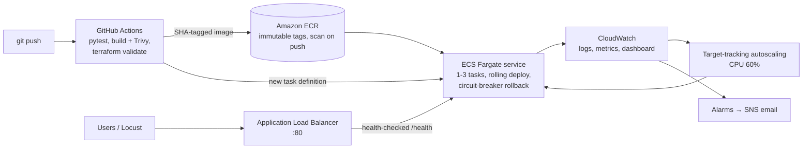

# CloudPose: a pose-estimation API, taken from a container to production-style AWS


CloudPose is a FastAPI service that runs Google's **MoveNet** model to find 17 body keypoints in a photo.
I used it as a realistic workload to practise the whole DevOps path: containerising it, running it on
Kubernetes with autoscaling and monitoring, load-testing it, fixing what broke, then rebuilding it on
**AWS ECS Fargate with Terraform** and a **GitHub Actions CI/CD** pipeline. I also wrote the same
infrastructure in **Pulumi** and **AWS CDK** (TypeScript) to compare the tools.

Every number below comes from a real run; the raw output is in [`evidence/`](evidence/).

## Results at a glance

| What | Result |
| --- | --- |
| **Fixed a production-style failure** | 100 concurrent users caused 4.3% failed requests and memory-limit pod restarts. Root cause: the model was loaded on every request. After loading it once per process: **0.02% failures (2 of 8,168), 0 restarts**, peak replicas 8 → 6 |
| Memory per instance (40 concurrent requests) | **1,675 MB → 502 MB**; throughput **10.6 → 20.9 req/s** |
| Kubernetes autoscaling (local 3-node cluster) | HPA scaled **2 → 8 pods in about 2 minutes** under load |
| AWS load test (100 users, 8 min, through the ALB) | **9,194 requests, 0 failures**, median 430 ms, **p95 980 ms**; ECS scaled **1 → 3 tasks** |
| Infrastructure as Code | One `terraform apply` creates **24 AWS resources**; state in S3 with native locking |
| CI/CD | Every push: tests, image build + vulnerability scan, Terraform validation. `main` deploys itself to ECS: **about 7 minutes from `git push` to live**, verified by a smoke test that checks the live version equals the commit SHA |

## Architecture (AWS)



* **Network:** only the ALB is public; task security groups accept traffic **only from the ALB**.
* **IAM:** separate task-execution and task roles (the app itself has zero AWS permissions); the
  CI/CD identity can only push to this ECR repository and update this one ECS service.
* **Ownership:** Terraform owns the infrastructure, the pipeline owns which image version runs, and
  autoscaling owns the task count (`ignore_changes` keeps them from fighting).

The local Kubernetes version uses the same app with a NodePort Service, an HPA, and
kube-prometheus-stack (Prometheus, Grafana, Alertmanager) installed **through Terraform's Helm provider**,
with my own `/metrics`, a Grafana dashboard and alert rules as code.

## Repository layout

| Path | What's inside |
| --- | --- |
| [`app/`](app/) | FastAPI service (`/pose/json`, `/pose/image`, `/health`, `/metrics`), non-root Docker image |
| [`tests/`](tests/) | PyTest suite (7 tests, including model-reuse and 32 parallel requests) |
| [`load/`](load/) | Locust load test and a smoke test |
| [`k8s/`](k8s/), [`infra/k8s/`](infra/k8s/) | Local 3-node kind cluster; Terraform for Deployment, Service, HPA and the monitoring stack |
| [`infra/aws/bootstrap/`](infra/aws/bootstrap/) | Terraform for the encrypted, versioned S3 state bucket |
| [`infra/aws/app/`](infra/aws/app/) | Terraform for ECR, ALB, ECS Fargate, autoscaling, CloudWatch alarms and dashboard, CI/CD identity |
| [`infra/pulumi/`](infra/pulumi/) | The same building blocks (ECR + secure S3 per environment) in **Pulumi + TypeScript** |
| [`infra/cdk/`](infra/cdk/) | The same building blocks in **AWS CDK + TypeScript** |
| [`.github/workflows/ci.yml`](.github/workflows/ci.yml) | CI/CD pipeline |
| [`evidence/`](evidence/) | Terraform/Pulumi output, Locust reports, screenshots |

## Engineering problems I solved

1. **Out-of-memory under load.** Grafana showed pod memory climbing to the 1 GiB limit. The code created a
   new TensorFlow Lite interpreter per request, so up to 40 copies of the model sat in memory.
   I load it once per process behind a lock: failures went from 4.3% to 0.02%.
2. **Health checks timing out.** CPU-bound inference inside `async def` blocked FastAPI's event loop, so
   `/health` couldn't answer and healthy pods risked restarts. Inference now runs in the thread pool.
3. **Locked-down AWS account.** An organisation-level policy (SCP) blocks creating a GitHub OIDC provider.
   The pipeline therefore uses a dedicated least-privilege deploy identity whose key never enters Terraform
   state; the OIDC path stays in code behind one variable (`cd_auth`) for normal accounts.
4. **Idempotent deploys.** The smoke test caught a misconfigured URL after a deploy; the pipeline now
   normalises it and skips re-pushing an image that already exists (ECR tags are immutable).
5. **Image scanning.** Docker Desktop pushed an OCI image index plus a provenance attestation, which
   basic ECR scanning skips. CI now builds with `--provenance=false`.

## Terraform vs Pulumi vs CDK (what I learned building all three)

| | Terraform | Pulumi | AWS CDK |
| --- | --- | --- | --- |
| Language | HCL | TypeScript (and others) | TypeScript (and others) |
| Who calls AWS | AWS provider | AWS provider | CloudFormation |
| State | S3 bucket I manage | Pulumi backend (local, S3, Cloud) | CloudFormation stack (in AWS) |
| On failure | stops where it failed | stops where it failed | automatic rollback |
| In this repo | full stack, 24 resources | 12 resources, `preview` / `up` / `destroy` | 40 lines → 11 CloudFormation resources |

## Run it yourself

```bash
# Tests
pip install -r app/requirements.txt pytest httpx && python -m pytest -q

# Local container
docker build -t cloudpose:dev app && docker run -p 60007:60007 cloudpose:dev
curl localhost:60007/health

# AWS (needs an AWS account and credentials)
cd infra/aws/bootstrap && terraform init && terraform apply          # state bucket, once
cd ../app && terraform init -backend-config="bucket=<your state bucket>" && terraform apply
```

**Cost note:** the running AWS stack costs roughly USD 3 per day (mainly the load balancer and one Fargate
task). `terraform destroy` in `infra/aws/app` removes everything except the small state bucket.

## Tech stack

Python, FastAPI, TensorFlow Lite, OpenCV, Docker, Kubernetes (kind), Helm, Prometheus, Grafana,
Alertmanager, Terraform, AWS (ECS Fargate, ECR, ALB, CloudWatch, SNS, IAM, S3), GitHub Actions, Trivy,
Locust, PyTest, Pulumi, AWS CDK, TypeScript.

## Acknowledgements

The pose model is **MoveNet** by Google (TensorFlow Hub, Apache License 2.0). The image pre- and
post-processing follows a MoveNet reference implementation.
